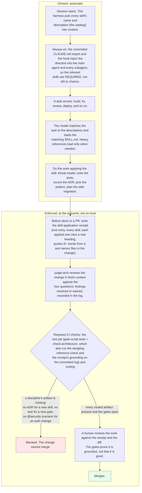
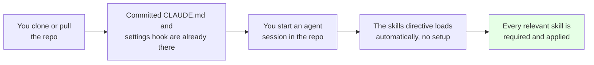
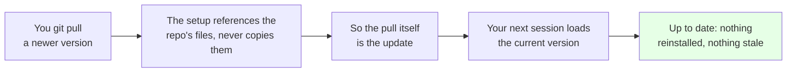
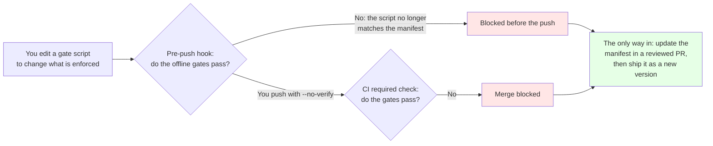
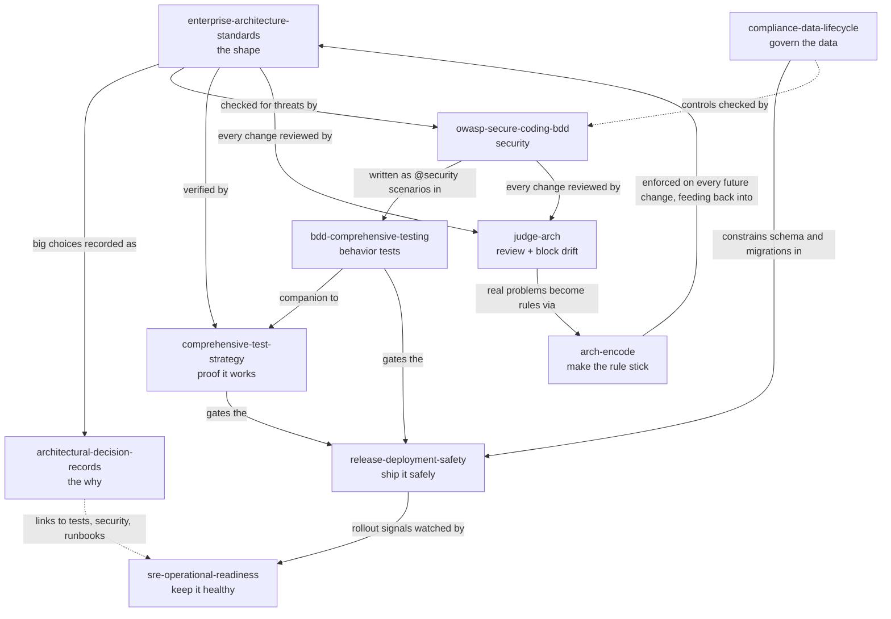

# Engineering Standards: Portable Agent Skills

[](LICENSE)
[](CONTRIBUTING.md)


Made and kept up by **[Tech Fleet](https://techfleet.org)**.

This repo holds 16 **skills**. A skill is a short, expert checklist. An AI coding
tool, or a person, reads it while doing the work. Each skill holds the know-how a
good senior engineer uses on a change: how to make it safe, how to test it, how
to ship it, and why a choice was made.

**What makes this different: the skills don't just sit there and hope. They get
enforced.** Lots of teams write down good rules. The hard part is that a rule you
only *read* is easy to skip, forget, or believe you followed when you didn't. In
our own projects, an AI tool often follows a rule it has only read maybe one time
out of five. So we built three things that work together to close that gap, and
you won't usually find them in one place:

**1. It sets itself up.** You don't have to install anything by hand. When you pull
this repo into a project, the skills and their checks turn themselves on, and they
stay in step every time the repo updates. There's nothing to wire up, and nothing
to remember.

**2. It asks the AI to show its work.** Each time the AI makes a change, it leaves a
receipt: which skills it used, the exact lines it followed, and the files it
touched. If it quietly skips a skill, the receipt comes up short, and that gets
caught. So "I did it" is something we can check, not something we have to take on
faith.

**3. It catches problems before they go live.** Each skill is paired with an
automatic check that runs when code is handed in. If the work didn't follow the
skill, the check doesn't pass, and the change waits until it does. A rule with no
check is really just a suggestion; the check is what makes it real. A second
reviewer also reads every change with fresh eyes.

The payoff is simple: careful, senior-level work happens on *every* change, not only
the ones an expert happens to see. And because it sets up and updates itself, every
project and every teammate stays on the same page, with no one left to babysit it.

> **New in v1.2: the checks travel.** Before, a project that adopted these skills got
> the reminders and a few self-protection checks, but no automatic checks on its *own*
> code. Now the engineering checks install into any repo that adopts them and run in that
> repo's CI, so adopting the skills *enforces* them, not just suggests them. One check
> line per gate, a single required check behind them, and a setup that can't be quietly
> weakened. Full details in [The checks travel to any repo (v1.2)](#the-checks-travel-to-any-repo-v12),
> and the release notes are in [CHANGELOG.md](CHANGELOG.md).

The 16 skills come in two groups, all under [`.claude/skills/`](.claude/skills/) so a clone
loads them automatically:

- **13 engineering skills.** They cover security, testing, architecture, releases,
  running in production, data rules, decision records, code review, rule-writing,
  provable checks, honest self-review, and picking a design pattern.
- **3 requirements skills.** They make what you build work for everyone: every
  browser and device, every ability, and anyone no matter their background.

The skills never name a specific AI model, company, or product. So they work with
any AI tool. They also read fine as plain notes for a person.

> **New here?** Think of a skill as a short checklist your AI coding tool reads on
> its own when it fits the task. For example: "You are changing the login code, so
> here is how to keep it safe." You do not have to remember to ask for it. Each
> skill says when it should load.

### A few words used here

- **Agent / AI coding tool:** an AI assistant that writes code for you.
- **LLM:** the AI model behind the tool.
- **BDD:** a way to write tests as plain sentences.
- **ADR:** a short note that records why a decision was made.
- **SRE:** the work of keeping a system healthy in production.
- **CI:** the automatic checks that run when you push code.
- **PR:** a pull request, the way you propose a change.
- **Gate:** a check that must pass before a change can merge.

---

## Table of contents

- [Why this exists](#why-this-exists)
- [The skills](#the-skills)
- [Requirements skills (works for everyone)](#requirements-skills-works-for-everyone)
- [What is a "skill"?](#what-is-a-skill)
- [Install and use](#install-and-use)
- [Always-on: run every skill on every task](#always-on-run-every-skill-on-every-task)
- [How a skill gets chosen and enforced](#how-a-skill-gets-chosen-and-enforced)
- [Set it up and keep it current: the bootstrap](#set-it-up-and-keep-it-current-the-bootstrap)
- [The checks travel to any repo (v1.2)](#the-checks-travel-to-any-repo-v12)
- [Three scenarios in plain English](#three-scenarios-in-plain-english)
- [Adopt the architecture gate, step by step](#adopt-the-architecture-gate-step-by-step)
- [How the skills fit together](#how-the-skills-fit-together)
- [Design principles](#design-principles)
- [Contributing](#contributing)
- [Repository layout](#repository-layout)
- [License](#license)
- [Acknowledgements](#acknowledgements)

---

## Why this exists

The thing that makes software production-ready is often **knowledge stuck in
people's heads**. The security engineer knows the lockout check must run before
the delete. The SRE wants a reliability target set before launch. The architect
knows why they picked one database over another. Not everyone has this knowledge.
It is easy to forget when a deadline is close. And it is almost never used on
every single change.

These skills take that knowledge and put it where the tool can read it. When
someone, or an AI tool, works on a feature, it pulls in the right skill and uses
it while doing the work. It checks the input for threats, writes the tests,
records the decision, and plans a safe database change. You do not have to hope a
reviewer catches the gap later.

Two kinds of people get value from the same files:

- **Engineers and AI-tool users** get a ready-made standard for security,
  testing, architecture, safe releases, and running the system.
- **Learners** get a clear, real picture of what careful, senior-level work looks
  like: the checklists, the trade-offs, and the "do not ship until..." rules.

---

## The skills

Each folder is one skill that stands on its own. The **When it kicks in** column
is a short version of the skill's `description`. That text is what the AI tool
uses to decide when to load the skill on its own.

| Skill | What it does | When it kicks in | Extra files |
|---|---|---|---|
| [`enterprise-architecture-standards`](.claude/skills/enterprise-architecture-standards/) | Designs the system and its data with real trade-offs: structure, resilience, and scale. | You design, build, or rework a service, database, API, or system. | 9 refs |
| [`pattern-selector`](.claude/skills/pattern-selector/) | Picks the software pattern that fits, or none, with the pros, cons, and trade-offs. | You design or rework any feature, class, module, or data flow; "which pattern?" | 5 refs, 1 script |
| [`architectural-decision-records`](.claude/skills/architectural-decision-records/) | Writes down why a big choice was made. | You make an important choice: database, framework, contract, or login model. | 5 refs, 2 scripts |
| [`owasp-secure-coding-bdd`](.claude/skills/owasp-secure-coding-bdd/) | Turns OWASP threat-modeling into runnable `@security` tests. | You touch login, input, sessions, files, APIs, permissions, dependencies, or AI code. | 15 refs |
| [`bdd-comprehensive-testing`](.claude/skills/bdd-comprehensive-testing/) | Writes every use case and audience as plain-sentence tests, checked on every push. | Any behavior change: build, add, fix, or push. | 4 refs, 5 scripts |
| [`comprehensive-test-strategy`](.claude/skills/comprehensive-test-strategy/) | Covers the rest of testing beyond BDD. | Any code others rely on: unit, integration, end-to-end, contract, load, chaos. | 5 refs |
| [`release-deployment-safety`](.claude/skills/release-deployment-safety/) | Ships at scale with no outage. | Deploy, release, roll out, migrate, cut over, hotfix, roll back, or feature flag. | 5 refs |
| [`sre-operational-readiness`](.claude/skills/sre-operational-readiness/) | Checks if it is safe to run in production. | Reliability targets, monitoring, alerts, on-call, incidents, runbooks. | 5 refs |
| [`compliance-data-lifecycle`](.claude/skills/compliance-data-lifecycle/) | Handles private and regulated data safely. | PII, GDPR/CCPA, SOC2/ISO, audit logs, retention, backups, recovery. | 5 refs |
| [`judge-arch`](.claude/skills/judge-arch/) | Reviews a change against four questions and blocks drift. | Before "done" or a PR: reviewing a diff, branch, or area. | 4 refs, 1 script |
| [`arch-encode`](.claude/skills/arch-encode/) | Turns a caught mistake into a tested, enforced rule. | After catching drift; "add a rule so this never happens again." | 2 refs |
| [`verifiable-quality-gates`](.claude/skills/verifiable-quality-gates/) | Proves each automated check can really catch a problem. | Adding or reviewing a CI check or guard; a green build you do not trust. | 3 refs, 2 scripts |
| [`skeptical-audit`](.claude/skills/skeptical-audit/) | Backs every claim of fact with proof you can re-run. | Any claim of fact: audits, reviews, status, counts, "I checked X." | 1 ref, 1 script |

### What each skill makes you do

**`enterprise-architecture-standards`** uses the architecture, database, and
performance standards you would expect from a senior team at a big company. It
picks a structure on purpose, designs the database around real trade-offs,
chooses sync or async for a reason, and builds in timeouts, retries, and limits
from the start instead of adding them later.

**`pattern-selector`** starts each feature by naming the problem as a set of
forces. Then it checks if a software pattern is even needed. Often the answer is no
software pattern. If one fits, it picks the right one and states the pros, the cons, the
problem it prevents, the safety and running trade-offs, the simpler option it
turned down, and a test that proves it was used right. It covers the 23 classic
software patterns plus enterprise, DDD, and security ones. It also lists anti-patterns for
when the job is to remove structure. A built-in check keeps every entry complete
and sourced.

**`architectural-decision-records`** treats a decision as unfinished until the why
is written down. It makes a numbered record (an ADR) in the same PR as the code.
The record names the options you did not pick and the downsides you accept. It
comes with scripts to create and check records.

**`owasp-secure-coding-bdd`** runs a threat-modeling pass against the full OWASP
Cheat Sheet Series, kept on disk with no web lookup. It applies the matching
safe-coding steps and writes them as runnable `@security` tests. It always runs
the lockout and accidental-delete safety check before any permission, access, or
delete change.

**`bdd-comprehensive-testing`** turns a change into the full set of behavior
tests: every use case (the happy path and every unhappy path), crossed with every
audience. It asks you when the audience is not clear, and never guesses. The tests
are written as valid Gherkin, a plain-sentence test format, and the official
parser checks them. They are sorted on a shared list, saved in the repo with an
add-only log, and checked on every push, so missing or broken coverage cannot
merge.

**`comprehensive-test-strategy`** owns the testing that behavioral BDD does not:
unit, integration, and end-to-end tests, contract tests between services, load
and chaos tests, property-based tests, and coverage and mutation checks. It also
shows how to keep flaky tests from rotting the suite.

**`release-deployment-safety`** turns "we merged it" into "it is safely live."
Zero-downtime deploys, canary, blue-green, and rolling rollouts, feature flags,
instant rollback, and database changes that stay backward-compatible so a deploy
never takes the system down.

**`sre-operational-readiness`** answers "is this safe to run?" before launch:
reliability targets and error budgets, the four golden signals, alerts that page
on real problems and not noise, incident response, blame-free postmortems,
runbooks, and a production-readiness review.

**`compliance-data-lifecycle`** handles personal and regulated data with care:
data classification, retention and deletion, audit logs you cannot tamper with,
GDPR/CCPA user rights, plus safe database changes, backups, and disaster recovery.

**`judge-arch`** reads a change the way a careful senior architect would, with
fresh eyes, against four questions. Is it in the right place? Who owns this data?
What does it now depend on? What happens when it breaks? It reports what it finds,
not fixes, or says PASS. It ships a small, dependency-free gate
(`arch-gate.mjs`) so the checkable rules block a merge instead of being just
advice. This is the layer that makes the other skills' standards actually stick.

**`arch-encode`** turns a caught mistake into a lasting rule: a clear "do not do
this" code example placed where the code lives, wired into the gate when it can be
checked, then proven to work by undoing the fix, clearing context, and running the
task again. It keeps rule files short and free of conflicts.

**`verifiable-quality-gates`** treats your automated checks as code that can
quietly stop working and still show green. A tightened pattern, a flipped
condition, or a moved file can break a check without anyone noticing. So each
check gets a saved test that runs the real check and fails when the check is
swapped for a do-nothing version. A mutation check proves this by machine. Checks
fail closed, and each rule is proven at the layer that owns it, not by a separate
monitor. It ships dependency-free coverage and mutation engines. This is the layer
that keeps the other skills' checks honest.

**`skeptical-audit`** treats your first answer as a guess until a measurement
proves it. Before any claim of fact ships, such as "it works," "tests pass," "it
is unused," "it is safe," or "I checked X," it attaches three things: an evidence
state (observed, inferred, documented, reported, or not-assessed), a source
someone else can re-run, and a named limit (what was not checked). It keeps "does
it follow the rule?" separate from "is the rule enough?", bans vague words used in
place of a real check, and gives an evidence list instead of comfort. An honest
"3 observed, 2 not-assessed" beats a confident "all good." It ships a
dependency-free `claim-lint` that flags vague words and untagged claims. This is
the layer that keeps every other skill's findings honest.

---

## Requirements skills (works for everyone)

The 13 skills above make software **correct**. These 3 make it **usable by
everyone**: every browser and device, every ability, and anyone no matter their
situation, reading level, or skill. The engineering skills ask "is this built,
secured, tested, and run correctly?" These ask "can anyone actually use what we
built?"

| Skill | What it does | When it kicks in |
|---|---|---|
| [`universal-browser-device-support`](.claude/skills/universal-browser-device-support/) | Works and looks right on every supported browser and device. | Any HTML/CSS/JS/UI change, responsive layout, "broken in Safari," mobile, touch. |
| [`universal-accessibility-wcag`](.claude/skills/universal-accessibility-wcag/) | Meets WCAG 2.2 AA so keyboard, screen-reader, and magnifier users are not shut out. | Forms, images, color and contrast, focus, keyboard, ARIA, screen readers. |
| [`usability-ux-universal-design`](.claude/skills/usability-ux-universal-design/) | Clear, simple design for the widest range of people. | New UI or flows, navigation, onboarding, empty and error states, wording. |

Use them in order on any UI change. First **works everywhere**: it loads and runs
wherever the user is. Then **accessible**: anyone with any ability can use it,
which is the floor the law often requires. Then **usable**: it is easy for anyone
on top of that.

---

## What is a "skill"?

A skill is a folder built around one `SKILL.md` file. It can have extra files the
tool reads only when it needs the detail:

```
<skill-name>/
  SKILL.md          # a short header (name + description) plus Markdown instructions
  references/*.md   # deep-dive material, read only when needed
  scripts/*         # optional helper scripts the skill can run
  assets/*          # optional drop-in files (templates, snippets)
```

`SKILL.md` starts with a short header, written in YAML, then plain Markdown:

```yaml
---
name: architectural-decision-records
description: "When to use this skill. This text is what triggers it."
---
# ...instructions in Markdown...
```

Two ideas make this work:

- **The `description` is a switch.** The AI tool reads it to decide if the skill
  fits the task. So it is written as *when to use this*, not *what this is*.
- **Load detail only when needed.** `SKILL.md` stays short and easy to scan. The
  heavy detail sits in `references/*.md` and loads only when the task needs it.
  This keeps the tool's context small.

This is, on purpose, the simplest shared format. Any tool that knows the SKILL.md
format reads it directly. Any model that does not can still read the file as plain
Markdown. Nothing here is tied to one company.

---

## Install and use

### AI tools that know SKILL.md (like Claude Code)

The skills live in this repo under [`.claude/skills/`](.claude/skills/), so you have options:

- **Work in this repo:** clone it and open a session here. Claude Code auto-discovers the
  skills from `.claude/skills/`, with no install step.
- **For all your projects, in one command:** run
  `node .claude/skills/bootstrap/scripts/esk-init.mjs --personal --yes --skills` to mirror every skill into
  `~/.claude/skills/` and turn the always-on hook on, kept current by re-running after a pull. Or copy a
  single skill folder into `~/.claude/skills/` by hand.
- **For one of your own repos, shared with the team:** copy the folder into that repo's
  `.claude/skills/` and commit it.

```bash
# clone, then use the skills right here (auto-discovered), or copy one out for all your projects
git clone https://github.com/techfleetworks/enterprise-software-AI-skills
cp -r enterprise-software-AI-skills/.claude/skills/architectural-decision-records ~/.claude/skills/
```

### Rule-based tools (Cursor, Copilot, Windsurf)

Point your project rules at the right `SKILL.md`, or paste its body into your rules
file. Add the `references/*.md` files when you work in that area.

### Any other model, custom tool, or RAG

Use `SKILL.md` as a system-prompt piece or a lookup document. (RAG means a setup
where the tool looks up documents to help answer.) Read the `description` to check
if it fits, then feed the Markdown body, and any linked file, as context. It is
all plain Markdown, so it drops into a vector store or a prompt with no conversion.

---

## Always-on: run every skill on every task

By default a skill loads only when the task matches its `description`. That leaves
coverage up to chance, and it can skip the review and check skills right when a
change is rushed. The [`always-on/`](always-on/) folder makes **every skill in
this repo always-on**: considered on every task, for the main tool and every
helper it spawns, added by the system instead of left to the model to remember.

It works through hooks, because Claude Code has no setting that forces a skill to
load. A `SessionStart` hook adds the rule to the main tool, and a `SubagentStart`
hook adds it to every helper. The rule names the skills and makes using the right
ones required. It does not paste in the full skill text, since their descriptions
are already always in context. A lighter option is to add the rule to `CLAUDE.md`.

The hook runs a tiny committed script, `always-on/emit-directive.mjs`, in exec form
(bare `node`, no shell), so it does not quietly break on a machine where bash is
missing, and if the rule file ever goes missing it says so loudly instead of turning
enforcement off in silence.

The easiest way to set this up, and to keep it current, is the bootstrap below, which
does it for you with a backup and a check. **Do not `cp` the directive or emitter into
`~/.claude`:** a copy freezes, and a later `git pull` updates the repo, not the copy (the
staleness trap this whole system exists to prevent). To wire it by hand instead, add a hook to
`~/.claude/settings.json` whose command runs this clone's own `always-on/emit-directive.mjs`
by absolute path (a reference, never a copy), so the pull is the update. See
[`always-on/settings.snippet.json`](always-on/settings.snippet.json) for the exact block.

Full steps, including personal vs project setup, the Windows fallback, the
confirm-it-works check, the CLAUDE.md option, and how to narrow it or turn it off, are
in the [`always-on/` README](always-on/).

---

## How a skill gets chosen and enforced

Two things decide whether a skill actually shapes a change: it has to be **chosen**, and the change has to be
**enforced** at the end. Selection is automatic: the `description` is the trigger, and the always-on layer
makes the relevant skills required instead of leaving them to chance. Enforcement is at the outcome: a
fresh-context review plus required CI checks, so a change that skipped a discipline cannot merge. This is the
difference between a skill that was *loaded* and one that was *obeyed*.



The selection half is the same mechanism any SKILL.md tool uses; the always-on layer and the enforcement half
are what this repo adds, so the right skill is not just available but required and then checked. The
`routing` check (change-type to required-artifact) is what turns "you should have recorded the decision" into
"this will not merge without the ADR."

On top of that, every change carries a **skill-application receipt** (`docs/skill-receipts/log.jsonl`): one
entry that covers every skill and, for each one applied, cites a real skill heading, quotes at least eight
exact words from under that heading, and names the files it shaped. `npm run check:receipt` checks the receipt
is complete and that each quote is a verbatim run from the cited section (so a fabricated, frontmatter, or
wrong-section quote is rejected); run it with `--changed-list <the diff>` to also check that the cited files
are in the change and that a coupled surface is marked applied. A silent skip becomes a failing empty cell.
None of this proves the work was done well, so a human still reviews it against the diff. The merge-blocking CI
job that passes the diff and base is deferred to the techfleetnetwork release. See
[`docs/specs/skill-application-receipt.md`](docs/specs/skill-application-receipt.md) and ADR-0038.

The always-on requirement covers sessions working in this repo. A session rooted outside the repo, or a cloud
session, needs the one-time installer; the [`always-on/` README](always-on/) has the full per-session
coverage map. The harness injecting the skill catalog (the first box) is the one part that happens in every
session.

---

## Set it up and keep it current: the bootstrap

Having the skills in a repo does nothing until they are actually loaded. This repo makes
the **directive** automatic for anyone who works in it, and keeps it current on **every pull**,
with two committed, repo-relative layers. The root cause of a stale setup is copying the directive
into `~/.claude`, where a pull never reaches it; both layers below instead point at the
repo's own files, so the pull is the update.

- **Layer 1, zero setup, no approval: the committed [`CLAUDE.md`](CLAUDE.md).** Claude Code
  loads a project `CLAUDE.md` from the working directory and its parents, and a relative
  import loads with no prompt. `CLAUDE.md` imports the directive, so a session rooted in the
  repo gets the current directive automatically, on every pull. It reaches the main agent and
  most subagents, but not a session rooted above or outside the repo.
- **Layer 2, stronger, one approval: the committed [`.claude/settings.json`](.claude/settings.json)
  hook.** It injects the same directive into every subagent, including the built-in Explore
  and Plan agents that skip `CLAUDE.md`. Claude Code asks each person once to trust the
  project hooks (a security prompt, not staleness); after that, content updates apply on pull.

To use the skills in **another project or machine**, the [`bootstrap`](.claude/skills/bootstrap/) skill's
installer references this repo (never copies), is safe by default (it never writes without
`--yes`, backs up first, validates, and restores on failure), records a version marker, and
`esk-init --check` is a CI drift gate that fails if someone is missing or behind. It verifies
honestly: it confirms the hook command emits the directive, and leaves the one true
end-to-end proof (open a fresh session and quote the directive) as a stated step, because a
script cannot watch the harness fire the hook.

```bash
node .claude/skills/bootstrap/scripts/esk-init.mjs            # plan only, writes nothing
node .claude/skills/bootstrap/scripts/esk-init.mjs --yes      # install or reconcile (backs up first)
node .claude/skills/bootstrap/scripts/esk-init.mjs --check    # CI drift gate: fails if not installed or behind
```

Here is the whole picture, from working in the repo to installing elsewhere and staying current:

```mermaid
flowchart TD
    subgraph INREPO["Working IN this repo: current on every pull, no install step"]
      P1["You git pull the repo"] --> P2["The repo ships two committed, repo-relative pieces,<br/>so the pull itself is the update (no copy to go stale)"]
      P2 --> L1["Layer 1 - CLAUDE.md imports the directive.<br/>Claude Code loads a project CLAUDE.md every session as context,<br/>and a RELATIVE import loads with NO approval prompt.<br/>Zero setup. Reaches the main agent and most subagents."]
      P2 --> L2["Layer 2 - .claude/settings.json runs emit-directive.mjs and<br/>injects the same directive into EVERY subagent, including the<br/>built-in Explore and Plan agents. One-time trust-the-hook<br/>approval per person; after that, content updates apply on pull."]
      L1 --> CUR["Your next session loads the CURRENT directive automatically.<br/>Nothing per-machine, nothing copied, nothing to fall behind."]
      L2 --> CUR
    end

    subgraph ELSEWHERE["Installing into ANOTHER project or machine: the bootstrap"]
      START2["A later session where the hook is installed: it emits the directive<br/>and, if the installed version is behind the repo, adds one line:<br/>an update is available, run the bootstrap. It never writes on its own."] --> VQ{"Installed version<br/>behind the repo?"}
      VQ -- "No" --> OK["Up to date. Nothing to do."]
      VQ -- "Yes, after a pull" --> U1

      B0["First time: run the bootstrap on purpose<br/>(README one-liner or invoke the skill)."] --> F1
      F1{"Unsaved changes, or on main / a shared branch?"}
      F1 -- "Yes" --> F1a["Stop. Offer a separate work folder and branch first."]
      F1a --> F2
      F1 -- "No" --> F2["Detect the repo + target settings. Never guess:<br/>anything unconfirmed is checked harder or asked, not assumed."]
      F2 --> F5["Show the WHOLE plan (create / merge / skip), then ask permission."]
      F5 --> F6{"Go ahead?"}
      F6 -- "No" --> F6a["Stop. Nothing written."]
      F6 -- "Yes" --> K["Install the hook POINTED AT THE REPO (reference, never copy),<br/>so a future git pull updates it. Merge into settings.json additively,<br/>back up first, log each step."]

      U1["Reconcile after a pull: re-point the hook at the repo, refresh the<br/>wiring, ask any NEW must-not-guess input. Same consent + backup."] --> K

      K --> V["Verify: run the hook command as configured and confirm it EMITS<br/>the directive and the settings entry is well-formed.<br/>(The hook canary cannot prove the harness fires it.)"]
      V --> VOK{"Valid + emits?"}
      VOK -- "No" --> VR["RESTORE from backup, do NOT write the marker."]
      VOK -- "Yes" --> M["Write the version marker + report. Then the only true proof:<br/>open a FRESH session and ask it to quote the directive;<br/>have it spawn a subagent and do the same."]
      M --> CHK["CI runs esk-init --check: fails if the hook is missing, drifted,<br/>or the installed version fell behind the repo."]
    end

    style F1a fill:#ffe6e6
    style F6a fill:#ffe6e6
    style VR fill:#ffe6e6
    style CUR fill:#e6ffe6
    style OK fill:#e6ffe6
    style M fill:#e6ffe6
    style L1 fill:#e6f0ff
    style L2 fill:#e6f0ff
```



> Scope note: the two committed layers (CLAUDE.md + the hook) and the installer own the always-on
> **directive** lifecycle (load, install, verify, reconcile, drift). The skills themselves live in the
> repo's committed `.claude/skills/`, which is a discovery location, so a pull makes them loadable for a
> session working IN the repo (and a cloud single-repo session) with no install. Coverage is not universal,
> though: a session rooted outside the repo loads the skills only after the per-machine installer mirrors
> them into `~/.claude/skills`, and a cloud multi-repo session does not read `~/.claude` at all. The coverage
> map is in the
> [`always-on/` README](always-on/#what-each-path-actually-covers). Turning on the engineering
> gates in an adopting repo (not just the directive) shipped in v1.2 through a second installer,
> `esk-genesis`, described in the next section; it plugs into the same plan, consent, backup, verify,
> and record framework.

---

## The checks travel to any repo (v1.2)

The bootstrap above turns on the **directive** (the always-on reminder to apply the skills). v1.2 adds the
other half: the **engineering checks themselves travel into a repo that adopts them and run in that repo's
CI**, so a skill is not just read, it is enforced on the adopting project's own code. A second installer,
`esk-genesis`, does this; `esk-init` (above) turns the directive on, and a fully protected repo runs both.

```bash
node .claude/skills/bootstrap/scripts/esk-genesis.mjs            # plan only, writes nothing
node .claude/skills/bootstrap/scripts/esk-genesis.mjs --yes      # install the gates + workflow (backs up first)
```

### How it works

- **A manifest is the single source of truth.** `gate-manifest.json` lists every gate: its script, a
  content hash, and how to run it. `esk-genesis` copies the gate scripts into the consumer's `scripts/ci/`,
  copies the manifest, and scaffolds one GitHub workflow. Nothing is hand-wired.
- **One required check, drift-proof.** The workflow runs every gate the manifest lists and rolls them up into
  a single required check (`enterprise-gates`). Because it runs *whatever the manifest lists*, adding or
  removing a gate never needs a branch-protection change.
- **One check line per gate.** The workflow shows each gate as its own check line, generated from the
  manifest, so a reviewer sees at a glance which one failed. (Some skills own more than one gate, so there are
  more gate lines than skills.) The per-gate lines are for visibility; the single summary check is the one that
  blocks a merge.
- **Two layers, same scripts.** The same gate scripts run in a **local pre-push hook** (a fast early catch,
  which you can skip with `--no-verify` and which is armed once per clone) and in **GitHub CI** (the
  authority, which cannot be skipped). Every check is offline except one (provenance, below), which needs the
  network and so runs only in CI.
- **It cannot be quietly weakened.** The provenance gate compares the committed manifest, including each
  gate's content hash and its scan scope, against the published release. A consumer that edits a gate or
  narrows what it scans fails provenance. The consumer's CI also runs each gate's own discrimination test, so
  a gate that was hollowed out to always pass is caught there too.

### Which checks travel, and why

Not every skill can be a mechanical check. A check becomes a travelling CI gate only if all five are true: it
reads files committed in the repo (not a report produced only when tests run); it is safe when there is
nothing to check (a repo with no database files just passes); it needs no hand-written setup to be useful (or
an empty default is still correct); its data travels with it (no separate file the installer leaves behind);
and it checks code, not a judgment call. Run through that test, the checks sort into four groups:

| Group | Count | Why |
|---|---|---|
| **Travel as CI gates** | 8 | Pass all five. `reference-links`, `no-ua-sniffing`, `owasp-lints`, `migration-safety`, `alert-hygiene`, `arch-gate`, `untagged-pii`, `retention-basis`. |
| **Protect the gate system itself** | 3 | Always run: `skill-gate-parity`, `manifest-provenance`, `bootstrap-presence`. They keep the gate set from being tampered with or dropped. |
| **Stay local only** | 2 | The accessibility conformance check needs a human-authored record; the test-shape check needs a live test report. Teams run these where they apply. |
| **Human judgment** | ~half the skills | Big design choices, pattern selection, operational readiness, honest self-review. No computer check is possible, so a person reviews them. |

This is deliberate and stated plainly: the gates cover the floors that can be checked by machine, and the
judgment work stays with human review. A green board means the floors held, not that the work is good.

> The full technical design (the manifest schema, the aggregator, provenance, and the genesis/reconcile flow)
> is in [`docs/design/bootstrap-v2/`](docs/design/bootstrap-v2/), and the decisions behind it are the ADRs
> numbered 0047 and 0056 through 0065 in [`docs/adr/`](docs/adr/).

---

## Three scenarios in plain English

Here is what actually happens in three everyday moments, each with a left-to-right picture of the flow.

### 1. You pull the skills repo for the first time

You clone or pull the repo. Two committed files do the setup for you: `CLAUDE.md` (which loads the skills
directive on its own) and `.claude/settings.json` (a hook that loads it for every agent, after a one-time
trust click). So the next time you start an agent session in the repo, the right skills load
automatically. Nothing to install. To use the skills from any other folder on your machine, you run the
bootstrap once.



### 2. You pull the skills repo and already had it

You git pull to get a newer version. Because the setup points at the repo's own files instead of copying
them somewhere else, the pull itself is the update. Your next session loads the new version automatically.
Nothing to reinstall, and nothing can quietly fall behind. If you installed the skills into other
projects, `esk-init --check` flags any that are behind, and a quick reconcile brings them current.



### 3. You try to change what the repo enforces

Say you edit a gate script to loosen a rule. The system is built so that cannot quietly happen. Your
pre-push hook runs the offline gates before the push, and the parity gate sees the script no longer
matches the manifest and stops you. If you push anyway with `--no-verify`, the same gates run in CI as a
required check and block the merge. The only way a change lands is the honest one: update the manifest to
match, in a reviewed pull request, and ship it as a new version.



## Adopt the architecture gate, step by step

The `judge-arch` and `arch-encode` skills come with a **gate** so your standards
are enforced, not just suggested. Here is how a team turns it on in a repo. It
takes about ten minutes, and your current code does **not** have to be clean first.

> On a **React + Supabase** codebase, skip the by-hand setup. Use the ready
> [`react-supabase` preset](.claude/skills/judge-arch/assets/presets/react-supabase/). It does
> steps 2 and 3 for you.

**1. Get the skills into the repo.** Clone this repo, or copy it in as a bundle.
Then copy the two review skills into your repo's committed skills folder so every
teammate's tool loads them:

```bash
git clone https://github.com/techfleetworks/enterprise-software-AI-skills
cp -r enterprise-software-AI-skills/.claude/skills/judge-arch   .claude/skills/
cp -r enterprise-software-AI-skills/.claude/skills/arch-encode  .claude/skills/
git add .claude/skills && git commit -m "Add architecture review + gate skills"
```

**2. Turn on the always-on rules.** Copy the vendor-neutral baseline into your
repo's `AGENTS.md`, make one if you do not have it, drop the scoped rules into the
folders they cover, and start a `decisions.md` that you fill with pointers to your
*own* good code:

```bash
cp enterprise-software-AI-skills/.claude/skills/judge-arch/assets/AGENTS.baseline.md      AGENTS.md
cp enterprise-software-AI-skills/.claude/skills/judge-arch/assets/decisions.template.md   decisions.md
# scoped rules, for example: src/components/AGENTS.md, src/services/AGENTS.md, supabase/functions/AGENTS.md
```

**3. Install the gate.** The scanner needs no `npm install`:

```bash
cp enterprise-software-AI-skills/.claude/skills/judge-arch/scripts/arch-gate.mjs                 scripts/arch-gate.mjs
cp enterprise-software-AI-skills/.claude/skills/judge-arch/assets/arch-gate.config.example.json  arch-gate.config.json
# edit arch-gate.config.json so its globs and forbidden patterns match your layers
```

**4. Record your current debt, so the gate is green on day one.** Make a waiver
file that grandfathers every current problem. The gate then blocks **new**
problems while your backlog is listed and dated. It only gets stricter over time:

```bash
node scripts/arch-gate.mjs --baseline > arch-gate.waivers.json
```

**5. Wire it into CI and your hooks.**

```jsonc
// package.json  ->  scripts
"check:architecture":     "node scripts/arch-gate.mjs --changed",  // checks changed files on a PR
"check:architecture:all": "node scripts/arch-gate.mjs"             // scans everything
```
```bash
cp enterprise-software-AI-skills/.claude/skills/judge-arch/assets/arch-gate.workflow.yml  .github/workflows/arch-gate.yml
# and add `npm run check:architecture` to your pre-push hook
```

From now on, **nothing is "done" until `check:architecture` exits 0 and a
`judge-arch` review is clean or waived on purpose.** The only way around it is a
dated, signed waiver. Never a self-declared "it is trivial." When you catch a
**new** bad pattern, use `arch-encode` to turn it into a rule and a gate check so
it cannot come back.

### Where each file goes, and what to change

Everything here is either the **shared standard**, which you use as-is, or a
**template** you copy into your repo and fill in. The full file-by-file map is in
[`.claude/skills/judge-arch/references/adoption.md`](.claude/skills/judge-arch/references/adoption.md). The main
ones:

| From the clone | Copy to your repo as | Edit after copying? |
|---|---|---|
| `.claude/skills/judge-arch/`, `.claude/skills/arch-encode/` (whole folders) | `.claude/skills/...` (committed) or `~/.claude/skills/...` | **No.** The shared skill and engine. |
| `.claude/skills/judge-arch/scripts/arch-gate.mjs` | `scripts/arch-gate.mjs` | **No.** The engine; your config drives it. |
| `.claude/skills/judge-arch/assets/AGENTS.baseline.md` | `AGENTS.md` | **Yes.** Add your specifics below the divider line. |
| `.claude/skills/judge-arch/assets/decisions.template.md` (or a preset's `decisions.md`) | `decisions.md` | **Yes.** Fill the good/bad lists with pointers to your own code. |
| a preset's `arch-gate.config.json` (or `assets/arch-gate.config.example.json`) | `arch-gate.config.json` | **Yes.** Set globs and client path to your folders. |
| a preset's `scoped/*.AGENTS.md` | the folder each one covers (for example `src/components/AGENTS.md`) | Usually **No**. |
| `.claude/skills/judge-arch/assets/arch-gate.workflow.yml` | `.github/workflows/arch-gate.yml` | Minor. Your Node version. |
| (generated, not copied) | `arch-gate.waivers.json` | `node scripts/arch-gate.mjs --baseline` |

**`AGENTS.md`, `decisions.md`, and `arch-gate.config.json` are templates.** The
files `AGENTS.baseline.md`, `decisions.template.md`, and the preset config are the
blanks in this repo. Every team copies them and points them at *their own* code.
Only the skill folders and the gate engine are used as-is.

---

## How the skills fit together

No skill works alone. One feature usually pulls in several, and they point to each
other on purpose. Architecture sets the shape. ADRs record why. Security and
testing prove it. Release and SRE get it live safely and keep it healthy.
Compliance governs the data under it.



The `architectural-decision-records` skill ties it together. Its records point to
the tests that confirm a choice, the security scenarios it needs, and the
operations plan it shapes.

---

## Design principles

- **No vendor names.** No model, company, or product names in skill content. So a
  skill works with any AI tool, and reads fine to a person.
- **Useful over complete.** Skills are short working standards, not textbooks.
  `SKILL.md` stays easy to scan. Depth goes in `references/`.
- **Load detail only when needed.** Read the short instructions first. Pull heavy
  reference material only when the task needs it.
- **Standards are required, but applied quietly.** The skills hold a firm bar
  ("not done until it is tested, secured, and recorded"). They do it by doing the
  work as part of the task, not by lecturing you about process.
- **Right-sized.** A three-line ADR for a small choice. The full test pyramid only
  for code others rely on. The skills also tell you when less is correct.

---

## Contributing

Contributions and forks are welcome. See [CONTRIBUTING.md](CONTRIBUTING.md) for the
full guide. In short:

1. Keep it **vendor-neutral**: no model, company, or product names.
2. Follow the **format**: `SKILL.md` with valid YAML frontmatter (put quotes
   around any `description` that has a `:`), depth in `references/`, and a
   kebab-case folder name that matches the frontmatter `name`.
3. Open a PR that says what the skill helps a tool do and **when it should load**.
   The `description` is what tools use to pick it.

Adding a new skill can be as small as one file:

```yaml
---
name: your-skill-name
description: "When to use this skill. This text is what triggers it."
---
# Instructions in Markdown...
```

---

## Repository layout

```
.
├── .claude/
│   ├── settings.json                  # committed always-on hook (SessionStart + SubagentStart)
│   └── skills/                        # the 16 skills plus the bootstrap installer, so a clone auto-discovers them
│       ├── enterprise-architecture-standards/
│       ├── architectural-decision-records/
│       ├── judge-arch/                # review a change + the gate that blocks drift
│       ├── arch-encode/               # turn a caught mistake into an enforced, tested rule
│       ├── verifiable-quality-gates/  # prove every automated check can really catch a problem
│       ├── skeptical-audit/           # back every claim with proof you can re-run
│       ├── pattern-selector/
│       ├── owasp-secure-coding-bdd/
│       ├── bdd-comprehensive-testing/ # every use case and audience as tagged, logged Gherkin
│       ├── comprehensive-test-strategy/
│       ├── release-deployment-safety/
│       ├── sre-operational-readiness/
│       ├── compliance-data-lifecycle/
│       ├── universal-browser-device-support/
│       ├── universal-accessibility-wcag/
│       ├── usability-ux-universal-design/
│       └── bootstrap/                 # the installer skill (esk-init)
├── always-on/                         # the directive + emitter the hooks inject
├── docs/                              # ADRs, audits, and the append-only arch-review log
├── test/                              # discriminating tests for every gate script
├── arch-gate.config.json              # the repo's own architecture-gate rules
├── CLAUDE.md                          # imports the always-on directive
├── package.json
├── CONTRIBUTING.md
├── LICENSE
└── README.md
```

Every skill folder follows the same shape: a `SKILL.md` file plus `references/`,
and optional `scripts/` and `assets/`. All of them live under `.claude/skills/`, so
Claude Code discovers them automatically when you work in the repo, and each is still
its own self-contained folder.

---

## License

[MIT](LICENSE) © [Tech Fleet](https://techfleet.org). Use, fork, change, and share
freely with attribution.

**One exception:** the `.claude/skills/owasp-secure-coding-bdd/vendor/` folder holds OWASP content
(the Cheat Sheet Series and the Top 10 for LLM Applications). OWASP publishes it
under **CC-BY-SA-4.0**, not MIT. It is fetched from source on demand by
`npm run vendor:owasp` and kept separate under its own license. It is not
committed. If you share that text, you must follow CC-BY-SA-4.0: give attribution
and share alike. The OWASP skill's own files describe the controls in their own
words and quote only short, credited bits, which fits this repo's MIT license. See
`.claude/skills/owasp-secure-coding-bdd/vendor/NOTICE.md`.

---

## Acknowledgements

The `architectural-decision-records` skill adapts the ADR practice and templates
from the ADR community ([adr.github.io](https://adr.github.io/)), Michael Nygard's
original ADR idea ("Documenting Architecture Decisions", 2011), and the MADR
project ([adr.github.io/madr](https://adr.github.io/madr/)).

The `owasp-secure-coding-bdd` skill is grounded in the
[OWASP Cheat Sheet Series](https://cheatsheetseries.owasp.org/), © the OWASP
Foundation.

The `judge-arch` and `arch-encode` skills are adapted from the certificates.dev
workshop "Who's Designing Your System? You, or Your Agent?"
